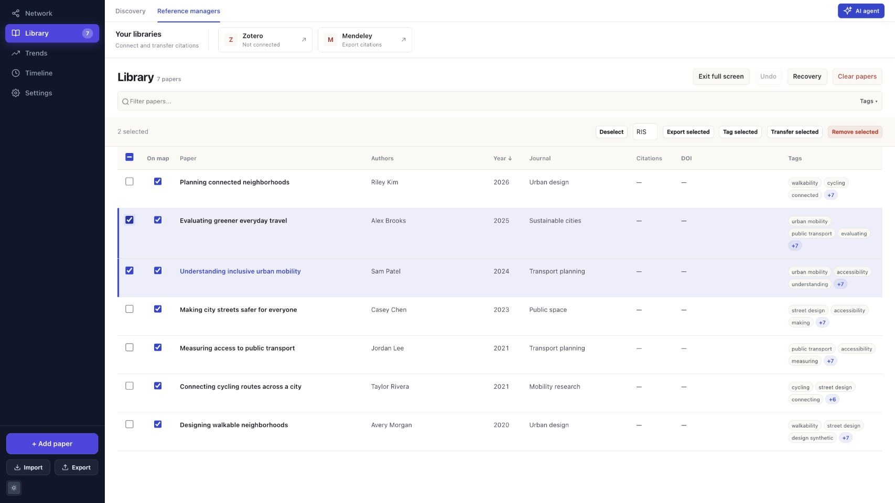
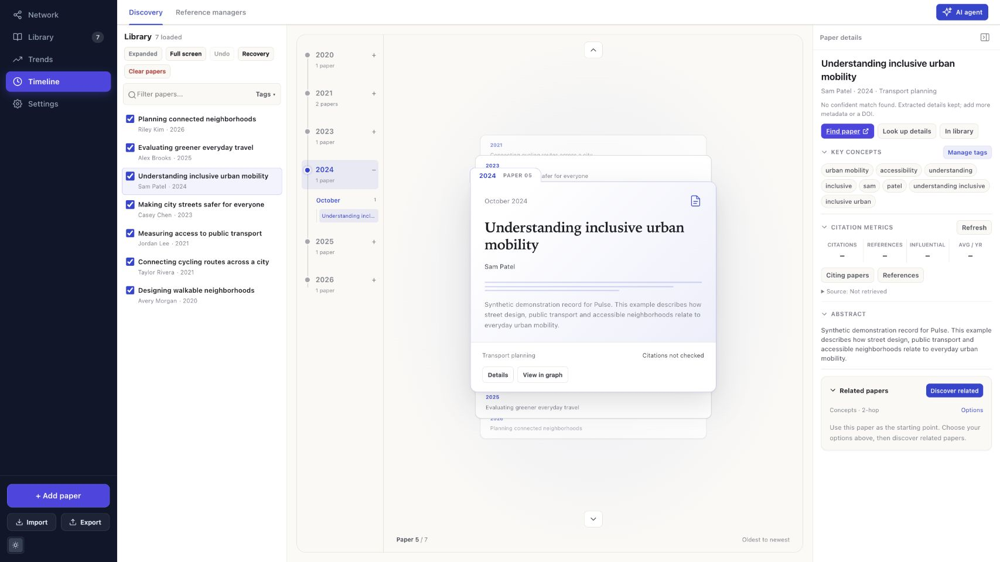

# Pulse

## A connected workspace for scientific literature discovery

**Capability white paper · Pulse 1.5.9 · 11 October 2026**

Pulse brings paper discovery, bibliography management, visual exploration and optional local AI reports into one Mac workspace. Begin with a DOI, a title, an imported PDF or a bibliography; confirm the paper's identity; explore related publications; and keep a collection that can be examined as a network, timeline or full-screen table.

**[Download Pulse 1.5.9 for Mac](https://github.com/7drbw7mdgf-lgtm/Pulse/releases/download/v1.5.9/Pulse-1.5.9.dmg)** · [Run from source](local-web/README.md) · [1.5.9 release notes](docs/releases/1.5.9.md) · [Issues](https://github.com/7drbw7mdgf-lgtm/Pulse/issues)

*This document describes Pulse 1.5.9; the linked installer is built from the same source. Screenshots use an isolated synthetic demonstration library, captured on 11 October 2026. They contain no user's reading list, and unavailable citation counts remain blank.*

## Abstract

Literature exploration connects several tasks: identifying a publication, tracing its neighbors, comparing evidence, deciding what to read and preserving a useful bibliography. Pulse connects these tasks around a shared local library. Citation-led discovery, concept search, several visual views, reference-manager integration and selected-paper AI reports support a repeating identify–explore–inspect–organize workflow.

The interface distinguishes a publication's identity, an index's reported evidence, a calculated relationship and an AI-generated interpretation. Researchers select the papers and check their contents. Pulse supports exploratory reviews and reading-list preparation; it does not establish the completeness of a systematic search or the validity of a scientific claim.

## 1. Capabilities at a glance

| Capability | What Pulse supports |
| --- | --- |
| Paper ingestion | PDF and bibliography imports, pasted identifiers or text, and file drops directly onto the graph |
| Metadata resolution | DOI-first lookup, followed by matching against available bibliographic metadata |
| Discovery | Up to 500 ranked results, references, incoming citations, recommendations and multi-source concept search |
| Exploration | Network, cluster and radial arrangements, a scrolling stacked timeline and bibliography views |
| Library management | Compact sidebar, full-screen table, search, filters, tags and sortable column headings |
| Bulk actions | Row selection to export, tag, transfer or remove several papers together |
| Recovery | Undo and saved recovery points for removals and cleared workspaces |
| Citation evidence | Provider-linked counts, check time, pageable citation/reference lists and coverage reporting |
| Local AI | Toolbar assistant for the selected paper, with cancellation and report downloads |
| Reference managers | Zotero Desktop transfer; Mendeley RIS export, shared sign-in service and protected library sync |
| MCP | Bibliographic library reads, metrics, citation/reference pages and explicitly chosen manager saves |

## 2. From imported files to identifiable papers

Pulse accepts DOI and PubMed identifiers, titles, pasted citations, PDF files and common bibliography formats, including BibTeX, RIS, CSV, JSON and supported EndNote records. PDFs can supply extractable text, document metadata and links. Drop supported paper files directly onto the network grid or use the sidebar's Add paper and Import controls.

The resolver extracts and normalizes DOI candidates, then attempts DOI lookup first. When that cannot identify the paper, it searches the available title, authors, year, journal and other bibliographic fields. Candidate agreement is checked; weak or ambiguous matches preserve the imported record. Source errors also preserve available metadata. Lookup runs automatically for imported and restored papers, and before citation export. Available date, volume, issue, pages or article number, publisher, ISSN/ISBN, language, URL and keywords are retained throughout exports and reference-manager sends. User corrections are preserved on subsequent refreshes; a registry cannot supply fields it has never received.

Readable source material matters. Image-only PDFs need OCR or manually supplied metadata; Pulse does not provide OCR or retrieve paywalled article text.

## 3. Discovery and citation evidence

Direct references reveal the work a seed paper cites. Incoming citations reveal work that cites it. Additional hops expand this neighborhood within configured limits. Co-citation connects papers cited together; bibliographic coupling connects papers that share references. Recommendations and concept searches can bring in publications outside an immediate citation path. Discovery options include a research question, preferred terms, soft avoids, strict phrase exclusions, depth and optional recency or impact preferences.

The 1.5.9 source creates focused title, abstract and keyword queries with bounded synonym/acronym expansion, and broadens sparse searches. It validates seed identities before following citations. Candidates retain their query ranks and are combined through reciprocal rank fusion, with one vote for mirrored results from the same query. BM25 title/abstract ranking and available local neural embeddings assess relevance; citation preference is off by default. Shared-reference similarity is normalised, while citation traversal includes recent and established work. Candidates are merged, deduplicated and ranked for review. Supported preprint/published pairs are grouped conservatively, and varied perspectives are included near the top. Relationship scores help navigation; they are not calibrated relevance probabilities or measures of scientific quality. A visible graph link does not establish that studies reach the same conclusion.

The **Discovery** and **Reference managers** ribbon tabs keep search and citation transfer separate. Choose up to **500 results** (200 by default), follow progress or cancel, filter by full text and inspect match reasons. Relevant / Not relevant labels stay in the local workspace and can be exported. A [20-case synthetic ranking benchmark](benchmarks/README.md) tracks Recall@50 and nDCG@10; it does not establish real-world retrieval accuracy.

Press the active ribbon tab again, or double-click it, to hide its tools and reclaim workspace height. Press it again to reopen; switching tabs opens the selected tools. Arrow keys move between tabs. The AI agent remains available in the top toolbar. Discovery and the inspector share one search configuration, and result action counts follow the papers actually selected.

The 1.5.9 source adds **Europe PMC** and **CORE** to concept searches, alongside Semantic Scholar. Source switches live in the shared Discovery options. Results retain provider labels and available full-text links, combine matching papers across indexes, and report any unavailable source. These services also provide metadata lookup fallbacks. CORE supports public search and an optional key in Settings for a larger allowance. See [Search sources](docs/SEARCH-SOURCES.md).

Citation metrics are retrieved only after a confirmed paper match. Counts retain their provider, source link and check time. Semantic Scholar and OpenAlex coverage can differ. Actual zero values remain **0**; missing counts appear as **—**. Influential counts are not estimated from totals. Average per year is a calculation from citation count and publication year, rather than a measured annual history.

**Citing papers** and **References** open filterable lists. Load more pages, stop loading, add records to Pulse or export the loaded results. List coverage is reported separately from the provider's headline count; all available pages describes that index's response, not every citation in existence.

## 4. A library that stays manageable

The library sidebar keeps titles and author/year lines compact, with full metadata available on hover and in the inspector. The navigation rail keeps the main views and paper actions together. Clicking a paper selects its details. Clicking empty graph space hides the inspector and gives the network more room; selecting a paper node reopens it. Hide/show controls are integrated into the details panel. Concepts, metrics, abstract and related papers collapse independently, and their state persists across paper selections and restarts.

The full-screen library is a table. Sort directly through its column headings; the duplicate sorting strip has been removed. Row-selection checkboxes are independent of map visibility. Export, tag, transfer and remove operate on the selected rows; selection hidden by filters is counted. The header selection control selects visible rows. Closing the library or Settings restores the original view's navigation highlight.

The timeline uses the available canvas height for a native scrolling deck. Neighboring papers form a visual stack; scrolling, card selection and keyboard navigation update the selected paper and its inspector. The publication rail scrolls independently. Expand a year to see months and known dates. A paper with only a month or year displays that available precision, without inventing a day or showing a missing-day placeholder.

Use **Undo** for the latest change or **Recovery** for saved removal and workspace recovery points. Recovery survives restarting Pulse. Removed papers merge into the current library. Restoring a cleared workspace recovers papers, tags, areas and map settings, while saving the current workspace first. Recovery is local to the Mac; JSON export makes a portable copy.

## 5. Selected-paper reports and reference managers

The **AI agent** button at the top right opens a reading assistant for the selected paper. It scans available extracted text or an abstract using local Ollama, with an optional focus, progress, cancellation and a downloadable report. Changing the selected paper changes the report context and cancels a running report for the previous paper. The main panel keeps model and service configuration out of the reading workflow.

Reports identify their source, including metadata-only records. A bibliography entry is not treated as evidence of methods or findings. Generated interpretations require checking against the article. Ollama and model weights are installed separately; basic library management works without AI.

The **Reference managers** ribbon provides Zotero and Mendeley actions. Zotero sends chosen metadata and abstracts to the currently selected editable library or collection in Zotero Desktop. Mendeley offers **Export for Mendeley** without developer registration: download a RIS file for the chosen scope, then import it in Mendeley.

**Shared Mendeley sign-in is implemented but not activated.** Pulse includes a deployable HTTPS service that keeps the confidential application's secret and provider tokens on the server. Once its owner completes registration and hosting, each user signs in and approves access; users and new devices do not enter developer settings. [Activation guide](docs/MENDELEY-ACTIVATION.md) · [Service deployment](auth-service/README.md).

Connected accounts can import their library automatically while Pulse is open, or use **Sync now**. Pulse reads every available page before applying results, preserves local edits and tags, and keeps removed papers out of automatic imports. Clearing pauses sync. Remote deletion does not remove local papers. Sending selected citations remains an explicit action. The current default installer has no activated shared service; local sign-in and sync tests use a simulated provider.

Direct manager transfers contain bibliographic metadata and abstracts. These operations do not upload PDFs or full paper text. Exported files remain local until the user imports them.

The included stdio MCP bridge exposes `pulse_papers`, `paper_metrics`, `paper_citations_references`, `library_manager_status`, `library_manager_search` and `library_manager_save`. Save operations require explicit intent and a configured destination. Tools omit full PDF text and never return credentials. Account setup remains in Pulse; the requesting MCP client's settings govern its handling of returned records.

## 6. Architecture and data flow

The current Mac app uses a Tauri shell, the `local-web/pulse-frontend` workspace and a Python backend served on localhost. Libraries, settings and recovery points are stored on the Mac. Scholarly matching and discovery contact online services including Semantic Scholar, OpenAlex, Crossref, PubMed, Europe PMC and CORE. Local Ollama reports and semantic reranking, optional cloud analysis and manager transfers have separate destinations.

| Operation | Data destination |
| --- | --- |
| Library, map and recovery | Local Pulse storage |
| Metadata lookup and discovery | Scholarly services used for that operation |
| Dedicated Ollama report and optional semantic reranking | Local Ollama on the Mac |
| Optional cloud analysis | Configured cloud provider |
| Direct reference-manager send | Chosen manager; metadata and abstract |
| MCP reads | Requesting MCP client |

Session authentication, loopback checks, protected credential storage, bounded extraction and background jobs support the local architecture. They are not an independent security certification. Index coverage, service limits, input quality, model resources and collection size affect results.

## 7. Availability, checks and getting started

The **[Pulse 1.5.9 Mac installer](https://github.com/7drbw7mdgf-lgtm/Pulse/releases/tag/v1.5.9)** contains the interface and search changes described here; the release page lists its SHA-256 checksum. To run from source instead, use the [source guide](local-web/README.md). The Mac app targets Apple Silicon on macOS 11 or later and requires Python 3.10 or later. PDF extraction dependencies are included in packaged builds; a Python interpreter, Ollama and model weights are installed separately. The installer is ad hoc signed and has not been notarized by Apple.

Download the DMG, drag Pulse into Applications and launch it. Add a seed paper, inspect its record, open Discovery options and review related candidates before adding them. The [installation guide](docs/MACOS-INSTALL.md) documents setup; the [source guide](local-web/README.md) supports a separate local test library.

For this release, **110 backend tests, 23 root workspace tests and 15 JavaScript suites passed**, alongside syntax checks and isolated browser verification on 11 October 2026. Checks cover parsing, metadata matching, query planning, ranking, provider paging, selected-paper reports, selection, bulk scope, recovery, timeline navigation and ribbon collapse using synthetic fixtures and mocked services. The repository also contains separate shared sign-in tests and packaging checks. Live account transfers remain dependent on account setup and authorization. These checks do not establish real-world search recall, summary accuracy or performance for every library.

See [development notes](docs/DEVELOPMENT.md) for source layout, checks, MCP and reproducible packaging. Historical root workspace files and tests remain for compatibility; the current desktop build stages the `local-web` source. Apple notarization, cross-platform installers, OCR, real-world discovery evaluation and quantitative summary evaluation remain outside the capabilities established here.
