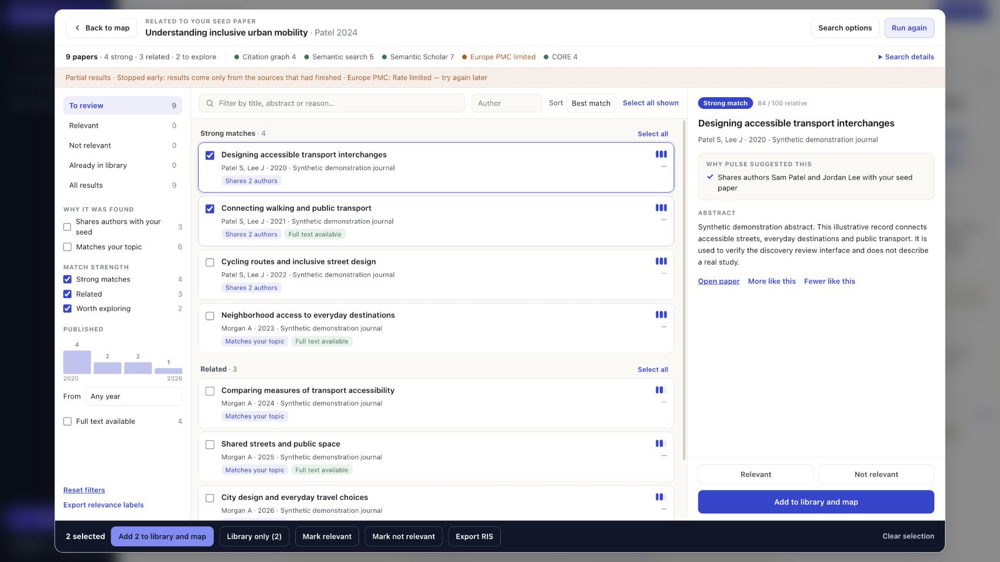
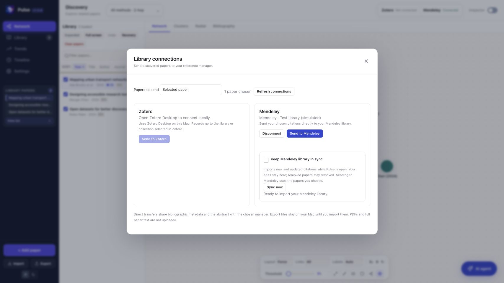

# Pulse

## A connected workspace for scientific literature discovery

**Capability white paper · Pulse 1.7.3 · 12 October 2026**

**Current source update (unreleased):** citation velocity now contributes up to **9 relevance-scaled score points**, and **Related** uses the top **40%** of the final candidate pool. Strong-match safeguards remain in place. See [unreleased changes](docs/UNRELEASED.md). The capability white paper below describes the published 1.7.3 release.

> **Local-first literature discovery for unpublished work.** Your library, PDFs and AI analysis stay on your computer. AI runs through local Ollama models by default, no account is needed, and your papers and manuscripts are never uploaded.

Pulse brings paper discovery, bibliography management, visual exploration and optional local AI reports into one desktop workspace. Begin with a DOI, a title, an imported PDF or a bibliography; confirm the paper's identity; explore related publications; and keep a collection that can be examined as a network, timeline or full-screen table.

**[Mac installer (1.7.3)](https://github.com/7drbw7mdgf-lgtm/Pulse/releases/download/v1.7.3/Pulse-1.7.3.dmg)** · [Windows installer (1.7.3)](https://github.com/7drbw7mdgf-lgtm/Pulse/releases/download/v1.7.3/Pulse-1.7.3-Windows-x64-Setup.exe) · [Run from source](local-web/README.md) · [1.7.3 release notes](docs/releases/1.7.3.md) · [Issues](https://github.com/7drbw7mdgf-lgtm/Pulse/issues)

*This document describes Pulse 1.7.3 with bridge discovery, full-text passages and the citation fallback and ranking safeguards below. The 1.7.1 screenshots use an isolated synthetic demonstration library, captured on 11 October 2026. Papers, source results and the rate-limit warning are simulated for interface verification; they contain no user's reading list. Unavailable citation counts appear as —. The older Mendeley screenshot is also a simulated account.*

Windows 10/11 (x64) packaging is available alongside the Mac app. The Windows setup bundles Python and the PDF reader, installs for the current user, and uses Microsoft WebView2. Ollama and model weights remain optional, separate installations. See [Windows installation and builds](docs/WINDOWS-INSTALL.md).

## Abstract

Literature exploration connects several tasks: identifying a publication, tracing its neighbors, comparing evidence, deciding what to read and preserving a useful bibliography. Pulse connects these tasks around a shared local library. Citation-led discovery, concept search, several visual views, reference-manager integration and selected-paper AI reports support a repeating identify–explore–inspect–organize workflow.

The interface distinguishes a publication's identity, an index's reported evidence, a calculated relationship and an AI-generated interpretation. Researchers select the papers and check their contents. Pulse supports exploratory reviews and reading-list preparation; it does not establish the completeness of a systematic search or the validity of a scientific claim.

## Why Pulse: local-first and private

Most literature-mapping tools run in the browser. They hold your reading list on their servers and, increasingly, send what you upload to a cloud language model. For a researcher with an unpublished manuscript, a confidential grant proposal, a pre-submission dataset or sensitive clinical material, that is often unacceptable, and institutional data policies may forbid it.

Pulse is built the other way round:

| | Pulse | Typical cloud literature tools |
| --- | --- | --- |
| Where your library lives | On your computer | On the provider's servers |
| PDFs and extracted full text | Read and kept on your computer; never uploaded | Often uploaded for processing |
| AI analysis | Local Ollama models by default; cloud AI only if you switch it on and add your own key | Cloud models |
| Account required | No | Usually |
| Works when a service shuts down or changes pricing | Yes; the library is a local file you own and can export | Depends on the provider |
| Source code | Open (MIT) and auditable | Usually closed |

**What does leave your computer, and why.** Discovery needs the public scholarly indexes. To identify papers and find related work, Pulse sends identifiers, titles, author and journal metadata, and your search terms (including any research question you type) to the services listed in [Architecture and data flow](#6-architecture-and-data-flow): Crossref, OpenAlex, Semantic Scholar, PubMed, Europe PMC, CORE and, if configured, Dimensions. These are the same lookups a researcher makes in a browser. Pulse does not send PDF files, extracted full text, notes, tags, relevance labels or AI prompts and reports to those services. Mendeley receives metadata only when you choose to send papers there; Zotero transfers go to Zotero Desktop on the same computer. If you enable the optional cloud AI provider, the text you ask it to analyse goes to that provider; leave it on local to keep analysis on your computer.

Avoid typing confidential wording into the research-question or search fields, because search terms are sent to the indexes. Everything you import, read and analyse stays local.

## 1. Capabilities at a glance

| Capability | What Pulse supports |
| --- | --- |
| Paper ingestion | PDF and bibliography imports, pasted identifiers or text, and file drops directly onto the graph |
| Metadata resolution | DOI-first lookup, followed by matching against available bibliographic metadata |
| Discovery | Up to 500 ranked results, live source progress, review queues, named match reasons, filters and a paper preview |
| Exploration | Network, cluster and radial arrangements, a scrolling stacked timeline and bibliography views |
| Library management | Compact sidebar, full-screen table, search, filters, tags and sortable column headings |
| Bulk actions | Row selection to export, tag, transfer or remove several papers together |
| Recovery | Undo and saved recovery points for removals and cleared workspaces |
| Citation evidence | Provider-linked counts, check time, pageable citation/reference lists and coverage reporting |
| Local AI | Toolbar assistant for the selected paper, with cancellation and report downloads |
| Reference managers | Zotero Desktop transfer; Mendeley RIS export, shared sign-in service and protected library sync |
| MCP | Bibliographic library reads, metrics, citation/reference pages and explicitly chosen manager saves |

## 2. From imported files to identifiable papers

Pulse accepts DOI and PubMed identifiers, titles, pasted citations, PDF files and common bibliography formats, including BibTeX, RIS, CSV, JSON and supported EndNote records. PDFs can supply extractable text, document metadata and links. Drop supported paper files directly onto the network grid or use the sidebar's Add paper and Import controls.

The resolver extracts and normalizes DOI candidates, then attempts DOI lookup first. When that cannot identify the paper, it searches the available title, authors, year, journal and other bibliographic fields. Candidate agreement is checked; weak or ambiguous matches preserve the imported record. Source errors also preserve available metadata. Lookup runs automatically for imported and restored papers, and before citation export. Available date, volume, issue, pages or article number, publisher, ISSN/ISBN, language, URL and keywords are retained throughout exports and reference-manager sends. User corrections are preserved on subsequent refreshes; a registry cannot supply fields it has never received.

**Identification safeguards (1.6).** A title alone is accepted only when it is a near-exact, in-order match; a title that differs by a meaningful word, or uses the same words in another order, is not treated as the same paper. Partial titles need two agreeing fields such as authors, year, journal or pages. Review and correction records (for example Faculty Opinions recommendations, peer-review reports and errata) are excluded from matching, Crossref and OpenAlex are both consulted, and numbered references such as `Huang C, et al. Title. Lancet 2020;395:497-506.` are parsed field by field. Where same-title records cannot be told apart, Pulse reports the paper as ambiguous instead of guessing. In a live check on 10 well-known titles, 1.6.0 identified all ten without attaching a wrong paper; 1.5.9 attached the wrong paper to two.

Readable source material matters. Image-only PDFs need OCR or manually supplied metadata; Pulse does not provide OCR or retrieve paywalled article text.

## 3. Discovery and citation evidence

Direct references reveal the work a seed paper cites. Incoming citations reveal work that cites it. Additional hops expand this neighborhood within configured limits. Co-citation connects papers cited together; bibliographic coupling connects papers that share references. Recommendations and concept searches can bring in publications outside an immediate citation path. Discovery options include a research question, preferred terms, soft avoids, strict phrase exclusions, depth and optional recency or impact preferences.

Pulse creates focused title, abstract and keyword queries with bounded synonym/acronym expansion, and broadens sparse searches. It validates seed identities before following citations. Candidates retain their query ranks and are combined through reciprocal rank fusion, with one vote for mirrored results from the same query. Forward and backward citation fallbacks run independently, so Semantic Scholar reference results cannot suppress OpenAlex citing-paper lookup. Recent and highly cited OpenAlex streams also recover independently. BM25 title/abstract ranking and available local neural embeddings assess relevance; a default age-adjusted citation-velocity prior contributes at most 2.5 score points and is weighted by topic relevance. Unknown counts or dates receive no bonus, and the optional foundational-paper preference adds a separate stronger tilt. Shared-reference similarity is normalised, while citation traversal includes recent and established work. Candidates are merged, deduplicated and ranked for review. Supported preprint/published pairs are grouped conservatively, and varied perspectives are included near the top. Relationship scores help navigation; they are not calibrated relevance probabilities or measures of scientific quality. A visible graph link does not establish that studies reach the same conclusion.

The **Discovery** and **Reference managers** ribbon tabs keep search and citation transfer separate. Choose up to **500 results** (200 by default), follow progress or cancel, filter by full text and inspect match reasons. Relevant / Not relevant labels stay in the local workspace and can be exported. A [20-case synthetic ranking benchmark](benchmarks/README.md) tracks Recall@50 and nDCG@10; it does not establish real-world retrieval accuracy.

**The discovery review workspace (1.7.1).** Results open in a three-column workspace: review queues and filters on the left, compact grouped paper rows in the center, and an abstract and match explanation on the right. Strong matches, Related and Worth exploring organize the list. **To review**, **Relevant**, **Not relevant**, **Already in library** and **All results** keep reading decisions separate from additions. Reasons name shared authors, citation paths and matching topics when that evidence is available; a search-only match stays labelled as such.

Each source reports its progress and any failure or rate limit. **Stop and review** retains candidates from completed searches and marks the result set as partial. Select individual papers or a group; the bulk bar counts the actual selection, including papers hidden by filters, and offers library/map addition, relevance labels and RIS export. Keyboard shortcuts support J/K to move, R/N to judge, A to add and Space to select. **Reset filters** clears the new reason and strength filters as well as text, date and full-text filters.

Press the active ribbon tab again, or double-click it, to hide its tools and reclaim workspace height. Press it again to reopen; switching tabs opens the selected tools. Arrow keys move between tabs. The AI agent remains available in the top toolbar. Discovery and the inspector share one search configuration, and result action counts follow the papers actually selected.

Pulse searches **Europe PMC** and **CORE** in concepts, alongside Semantic Scholar. Source switches live in the shared Discovery options. Results retain provider labels and available full-text links, combine matching papers across indexes, and report any unavailable source. These services also provide metadata lookup fallbacks. CORE supports public search and an optional key in Settings for a larger allowance. See [Search sources](docs/SEARCH-SOURCES.md).

Citation metrics are retrieved only after a confirmed paper match. Counts retain their provider, source link and check time. Semantic Scholar and OpenAlex coverage can differ. Actual zero values remain **0**; missing counts appear as **—**. Influential counts are not estimated from totals. Average per year is a calculation from citation count and publication year, rather than a measured annual history.

**Citing papers** and **References** open filterable lists. Load more pages, stop loading, add records to Pulse or export the loaded results. List coverage is reported separately from the provider's headline count; all available pages describes that index's response, not every citation in existence.

## 4. A library that stays manageable

The library sidebar keeps titles and author/year lines compact, with full metadata available on hover and in the inspector. The navigation rail keeps the main views and paper actions together. Clicking a paper selects its details. Clicking empty graph space hides the inspector and gives the network more room; selecting a paper node reopens it. Hide/show controls are integrated into the details panel. Concepts, metrics, abstract and related papers collapse independently, and their state persists across paper selections and restarts.

The full-screen library is a table. Sort directly through its column headings; the duplicate sorting strip has been removed. Row-selection checkboxes are independent of map visibility. Export, tag, transfer and remove operate on the selected rows; selection hidden by filters is counted. The header selection control selects visible rows. Closing the library or Settings restores the original view's navigation highlight.

The timeline uses the available canvas height for a native scrolling deck. Neighboring papers form a visual stack; scrolling, card selection and keyboard navigation update the selected paper and its inspector. The publication rail scrolls independently. Expand a year to see months and known dates. A paper with only a month or year displays that available precision, without inventing a day or showing a missing-day placeholder.

Use **Undo** for the latest change or **Recovery** for saved removal and workspace recovery points. Recovery survives restarting Pulse. Removed papers merge into the current library. Restoring a cleared workspace recovers papers, tags, areas and map settings, while saving the current workspace first. Recovery is local to your computer; JSON export makes a portable copy.

**The paper inspector (1.7).** Selecting a paper opens a panel with a fixed header: ‹ › steps through the library in its current order, a compact line gives authors, year, journal and pages, and chips show DOI status, the discovery seed and your reading status. Open paper and Discover related are always visible; maintenance actions, Copy citation and Send to Zotero or Mendeley sit in a ⋯ menu. Three tabs organise the rest. **Overview** puts the abstract first, then citation metrics, key findings and concepts. **Connections** shows the paper's links to your other papers, with their type, strength and shared concepts, and then citing papers, references and discovery. **Notes** holds your reading status, relevance, personal tags and private notes. These personal fields are stored with your library on your computer, included in JSON exports, and your tags join the library filter.

## 5. Selected-paper reports and reference managers

The **AI agent** button at the top right opens a reading assistant for the selected paper. It scans available extracted text or an abstract using local Ollama, with an optional focus, progress, cancellation and a downloadable report. Changing the selected paper changes the report context and cancels a running report for the previous paper. The main panel keeps model and service configuration out of the reading workflow.

Reports identify their source, including metadata-only records. A bibliography entry is not treated as evidence of methods or findings. Generated interpretations require checking against the article. Ollama and model weights are installed separately; basic library management works without AI.

The **Reference managers** ribbon provides Zotero and Mendeley actions. Zotero sends chosen metadata and abstracts to the currently selected editable library or collection in Zotero Desktop. Mendeley offers **Export for Mendeley** without developer registration: download a RIS file for the chosen scope, then import it in Mendeley.

**Shared Mendeley sign-in is implemented but not activated.** Pulse includes a deployable HTTPS service that keeps the confidential application's secret and provider tokens on the server. Once its owner completes registration and hosting, each user signs in and approves access; users and new devices do not enter developer settings. [Activation guide](docs/MENDELEY-ACTIVATION.md) · [Service deployment](auth-service/README.md).

Connected accounts can import their library automatically while Pulse is open, or use **Sync now**. Pulse reads every available page before applying results, preserves local edits and tags, and keeps removed papers out of automatic imports. Clearing pauses sync. Remote deletion does not remove local papers. Sending selected citations remains an explicit action. The current default installer has no activated shared service; local sign-in and sync tests use a simulated provider.

Direct manager transfers contain bibliographic metadata and abstracts. These operations do not upload PDFs or full paper text. Exported files remain local until the user imports them.

The included stdio MCP bridge exposes `pulse_papers`, `paper_metrics`, `paper_citations_references`, `library_manager_status`, `library_manager_search` and `library_manager_save`. Save operations require explicit intent and a configured destination. Tools omit full PDF text and never return credentials. Account setup remains in Pulse; the requesting MCP client's settings govern its handling of returned records.

## 6. Architecture and data flow

The desktop app uses a Tauri shell, the `local-web/pulse-frontend` workspace and a Python backend served on localhost. Libraries, settings and recovery points are stored on your computer. Scholarly matching and discovery contact online services including Semantic Scholar, OpenAlex, Crossref, PubMed, Europe PMC and CORE. Local Ollama reports and semantic reranking, optional cloud analysis and manager transfers have separate destinations.

| Operation | Data destination |
| --- | --- |
| Library, map and recovery | Local Pulse storage |
| Metadata lookup and discovery | Scholarly services used for that operation |
| Dedicated Ollama report and optional semantic reranking | Local Ollama on your computer |
| Optional cloud analysis | Configured cloud provider |
| Direct reference-manager send | Chosen manager; metadata and abstract |
| MCP reads | Requesting MCP client |

Session authentication, loopback checks, protected credential storage, bounded extraction and background jobs support the local architecture. They are not an independent security certification. Index coverage, service limits, input quality, model resources and collection size affect results.

## 7. Availability, checks and getting started

The **[Pulse 1.7.3 release](https://github.com/7drbw7mdgf-lgtm/Pulse/releases/tag/v1.7.3)** includes Mac and Windows installers for these capabilities. To run from source instead, use the [source guide](local-web/README.md). The Mac app targets Apple Silicon on macOS 11 or later and requires Python 3.10 or later. PDF extraction dependencies are included in packaged builds; a Python interpreter, Ollama and model weights are installed separately. The installer is ad hoc signed and has not been notarized by Apple.

Download the DMG, drag Pulse into Applications and launch it. Add a seed paper, inspect its record, open Discovery options and review related candidates before adding them. The [installation guide](docs/MACOS-INSTALL.md) documents setup; the [source guide](local-web/README.md) supports a separate local test library.

The release checks cover parsing, provider fallbacks, search budgets, ranking, match-strength gates, selection, recovery and interface behavior using synthetic fixtures and mocked services. Native packaging checks verify app version, isolated library persistence, PDF extraction, full-text passage APIs, session authentication and shutdown. Live account transfers depend on service activation and authorization. These checks do not establish real-world search recall, summary accuracy or performance for every library.

See [development notes](docs/DEVELOPMENT.md) for source layout, checks, MCP and reproducible packaging. Historical root workspace files and tests remain for compatibility; the current desktop build stages the `local-web` source. Apple notarization, OCR, real-world discovery evaluation and quantitative summary evaluation remain outside the capabilities established here.

## Search quality

Discovery preserves concept phrases and synonyms, balances a larger candidate pool across sources, streams partial results under provider budgets, and uses your Relevant / Not relevant judgements when you refine the same research question. Optional local pairwise ranking assesses the question and abstract together; a **Strong match** additionally needs a final rank in the top 10% of the deduplicated candidate pool and at least two independent retrieval channels. Query variants and mirrored indexes count as one concept-search channel. Absolute evidence thresholds still apply, and explicit user relevance labels remain separate.

[Search evaluation and reproducible real-paper benchmarks](benchmarks/README.md) describe the ranking, local model setup, published SciFact evaluation and its limits. Feedback is saved in the workspace; recommendation APIs receive relevant/rejected paper identifiers when those examples are used in a search.

## Bridge discovery and full-text evidence

Select 2–8 rows in the Library table (or a graph link), open Discovery options and enable **Find bridge papers**. Pulse searches combined seed concepts, prioritises candidates with evidence for at least two seeds and explains each connection. Added bridge papers link to the supported seeds on the map. These are connections between selected research directions; Pulse does not infer disciplinary boundaries from a paper title.

**Read source passages** retrieves open-access PMC article bodies through Europe PMC, or matches a locally imported S2ORC record by DOI, PMCID or Semantic Scholar identifier. Passages keep section names, source links, permission information and retrieval dates. **Search full-text library** includes indexed passage matches in discovery; body snippets remain distinct from abstracts. Missing text preserves the available abstract.

Local AI uses `nomic-embed-text` for meaning search, `llama3.2:3b` for optional relevance review and `qwen2.5:7b` for selected-paper reports. Reports use only the selected paper; retrieved passage sets are labelled with coverage limits. AI review is a bounded shortlist, keeps uncertain results available and does not override explicit user relevance labels. Model roles are configurable in Settings. The diagram's latency and throughput figures are design targets, not measured guarantees.

Import JSONL or JSONL.GZ S2ORC excerpts up to 20 MB in Settings → Full-text library. For larger local shards, use `python3 tools/import_s2orc.py /path/to/shard.jsonl.gz --profile /path/to/pulse-profile`; input is streamed and no corpus is downloaded automatically. Obtain the source dataset through the [official S2ORC distribution](https://github.com/allenai/s2orc) and retain attribution and applicable article rights. PMC coverage is limited to [available open-access article XML](https://europepmc.org/RestfulWebService).

## License

Pulse is released under the [MIT License](LICENSE). You may use, modify and redistribute it, including in commercial work, provided the copyright and license notice are kept. The software is provided without warranty.
