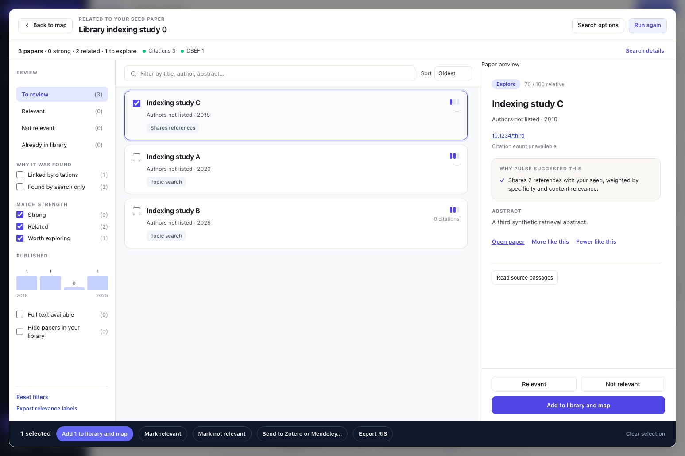
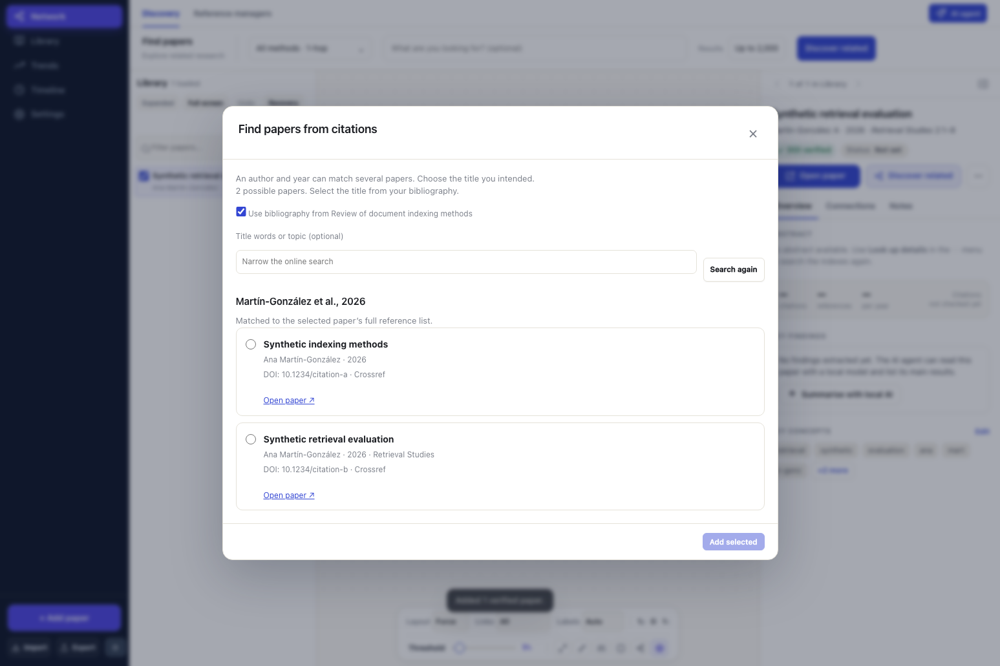
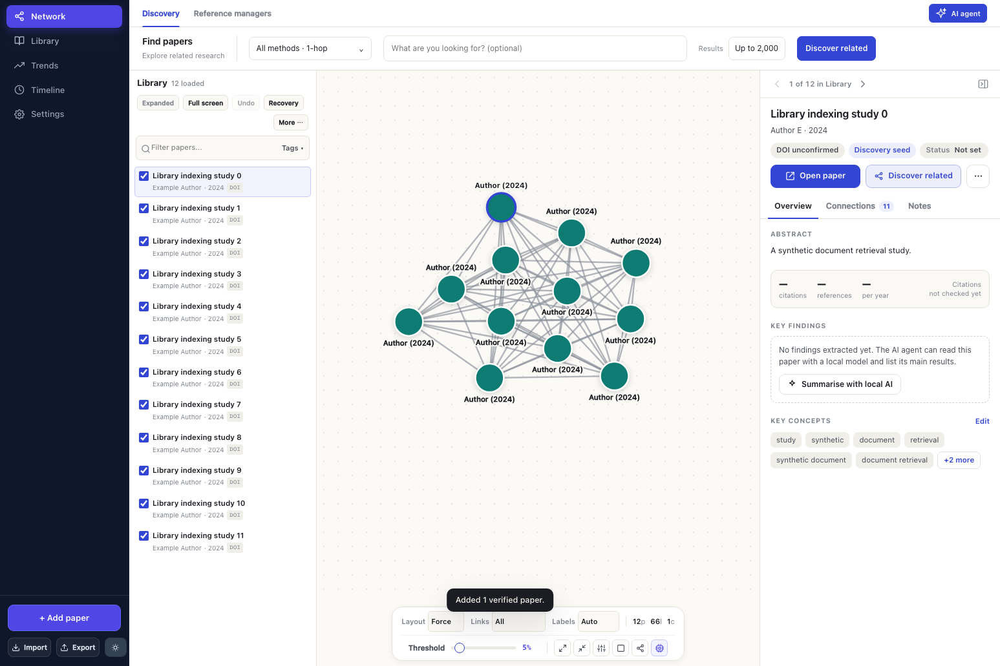
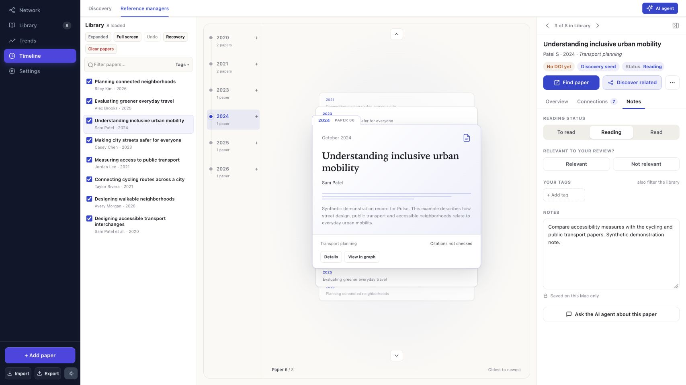
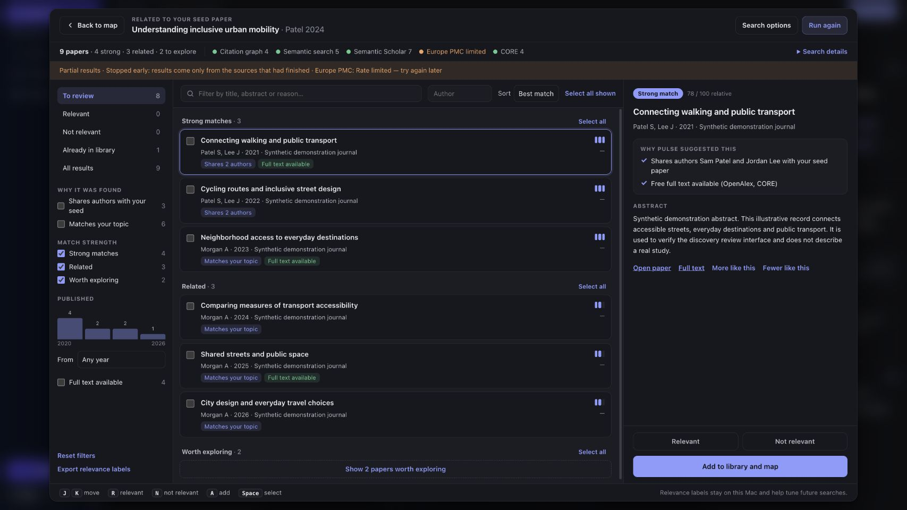
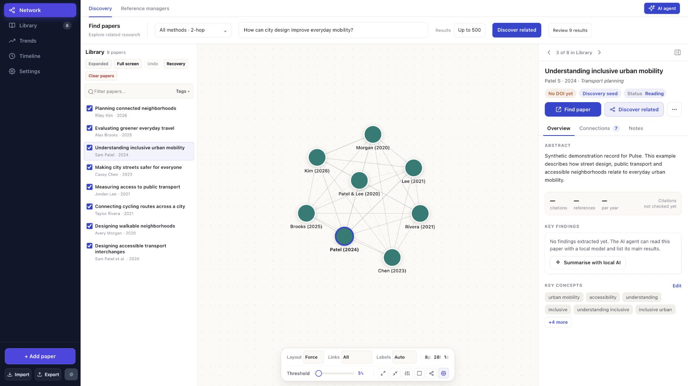
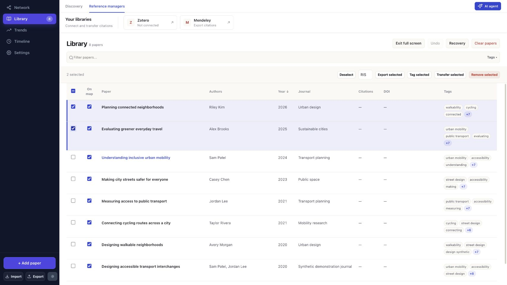

# Pulse

### A private, local-first workspace for scientific literature discovery and synthesis

[](https://github.com/7drbw7mdgf-lgtm/Pulse/releases/tag/v1.8.4)
[](LICENSE)
[](https://github.com/7drbw7mdgf-lgtm/Pulse/releases)

---

**[Download for Mac (Apple Silicon)](https://github.com/7drbw7mdgf-lgtm/Pulse/releases/download/v1.8.4/Pulse-1.8.4.dmg)** &nbsp;|&nbsp; **[Download for Windows (x64, 1.8.0)](https://github.com/7drbw7mdgf-lgtm/Pulse/releases/download/v1.8.0/Pulse-1.8.0-Windows-x64-Setup.exe)** &nbsp;|&nbsp; **[Release Notes](docs/releases/1.8.4.md)** &nbsp;|&nbsp; **[Run from Source](local-web/README.md)**

---

> **Why Pulse?** Most research-mapping tools live entirely in the browser. They store your reading lists on remote servers and send what you upload to third-party cloud language models.
> 
> If you are working on an **unpublished manuscript, a confidential grant proposal, a patent application, or sensitive clinical data**, that's a security and privacy risk.
>
> **Pulse is built to be local-first.** Your library, PDFs, reading notes, and AI analysis stay strictly on your computer.

---



## What’s new in 1.8.4

- **Results while you wait:** a preliminary ranking appears as soon as the citation searches finish (first results in about 2–4 s cold) and updates as slower sources answer; final rankings are unchanged.
- **Pre-warm on selection:** keep a paper selected for a moment and Pulse prepares its search in the background, so the search then takes about 3 s instead of about 10 s. Capped to protect OpenAlex's daily limit.
- **Keeps working when OpenAlex is limited:** 7-day cache for stable lookups, Europe PMC / NIH iCite / OpenCitations citation fallbacks, a notice showing when OpenAlex resumes, and an optional OpenAlex API key in Settings.

See the [1.8.4 notes](docs/releases/1.8.4.md).

## What’s new in 1.8.3

- **Drag papers from the Library onto the map**, placing them exactly where you drop them.
- **Pan / box-select toggle** in the floating map controls: drag a box (or Shift-drag) to select papers, Shift- or ⌘-click to add or remove one.
- **Bridge your selection:** with 2–8 papers selected, **Find bridges** searches for the concepts they share (grounded in at least two of the papers) and ranks papers that connect them.
- **Simpler search bar:** the Search papers button is gone; the wider bar runs a concept search when you press **Enter**.

See the [1.8.3 notes](docs/releases/1.8.3.md).

## What’s new in 1.8.2

- **Persistent offline ranker:** the Mac cross-encoder now loads once and stays running, saving about 0.4 s per search after the first, with bit-identical rankings to 1.8.1. See the [1.8.2 notes](docs/releases/1.8.2.md), including a note on OpenAlex's daily limits.

## What’s new in 1.8.1

- **Steadier search times:** fixed a background-ranking stall that could add up to 12 seconds to a search. The slowest of five test searches fell from 22.8 s to 12.7 s; the typical first search stays about 11.5 s, now mostly time spent collecting from public services.
- **Background work on the right papers:** while sources are still answering, Pulse prepares exactly the papers its final ranking will assess. The final order is unchanged.
- **Citations from OpenAlex first,** with Semantic Scholar only when needed and OpenCitations as a keyless fallback.
- **Results while ranking finishes:** a first ordering appears straight away. Once you start marking papers, your order is kept and **Apply refined order** is offered.
- **Smaller cache:** compressed responses use about 18 MB for five searches instead of 107 MB.
- **Fixed Allow helper** in the Mac DMG.

1.8.0 added the direct-citation influence bonus, a persistent HTTP cache and keyless arXiv search; see the [1.8.0 notes](docs/releases/1.8.0.md). Full measurements and limits are in the [1.8.1 notes](docs/releases/1.8.1.md).

## What’s new in 1.7.12

### Faster discovery
- **Parallel shared-reference (DBEF) searches** with trimmed OpenAlex responses (`select=`), reusable HTTP connections, and background pre-warming of references and DBEF pivots when you select or add a paper.
- **Early settling:** long-tail collection stops once the leading results are stable.
- **Lighter neural ranking:** balanced shortlists of 96 embeddings and 48 single-excerpt cross-encoder scores, with score caching.
- **Measured live:** on five seed papers (bacterial outer-membrane vesicles, 200 results, Apple Silicon Mac, one run each), a full search took **12.5–15.4 s**, down from 21.7–30.6 s in 1.7.11. Of 75 citation-derived must-find papers, 15 ranked in the top 50 (1.7.11: 13) and 43 in the top 200 (1.7.11: 51); early settling trims some long-tail results. This is a small, single-field check, not a general guarantee.

### Map tabs
- **Multiple maps per workspace:** ribbon tabs and **+ New map** create independent maps, including blank ones, that share one library.
- Library cards, the library table and the bulk **Add to map…** action assign papers to a chosen map, all maps or none. Map membership persists across save, export, restore and recovery.

### Concept search
Type a concept, key phrases or a research question into **Find papers** and press **Enter**. No seed paper is required. Pulse uses the configured AI to extract focused keywords and close synonyms, searches the selected literature indexes, and ranks results against the original topic. The original phrase always remains a query; if AI is unavailable, Pulse falls back to phrase search with a clear notice.

### Calibrated citation evidence
- **DBEF calibration:** a seed-derived saturation scale replaces batch-max normalisation, so one weak shared reference can no longer score like a dense cluster.
- **Missing data handled honestly:** assessed overlap, assessed zero and unavailable graph evidence are recorded separately; missing graph support is imputed conservatively.
- **Co-citation restored** as its own eight-second search beside direct citations and bibliographic coupling. The citation-velocity bonus is still counted once.

### Research quality
- **Better relevance feedback:** positive and negative examples teach question-specific preferred and rejected concepts.
- **Stronger citation checks:** column-aware reference extraction and local English OCR for scanned PDFs. DOI verification also checks initials, journal, volume, issue, pages and dates; conflicts stay reviewable.
- **Publication updates:** linked preprints and published versions are grouped, and verified papers show recorded corrections, concerns and retraction notices.
- **Benchmarks:** frozen three-case and five-seed benchmarks report condensed nDCG, known-paper/landmark recall and every judged paper’s rank change. Results are mixed and too few to establish significance. See the [calibration guide](docs/search/DBEF-CALIBRATION.md), [ranking benchmark](docs/search/RANKING-BENCHMARK.md) and [quality guide](docs/search/QUALITY-UPGRADE.md).

## What’s new in 1.7.11

- **Bibliography-first lookup:** author–year citations use the selected paper’s full reference list before online search, including explicit `2026a`/`2026b` suffixes. Bibliography tails survive long PDF imports and workspace recovery.
- **Verify before adding:** choosing a citation fetches the DOI record and checks the title, authors and publication dates. Complete registry metadata leads; mismatches and unavailable verification leave the library unchanged. Exports recheck records that have not passed identity verification, preserving personal corrections.
- **Source backoff:** rate limits and repeated HTTP/connection failures pause the affected credential scope. Cached successes and other sources continue. Search details show provider contributions and retry times. Local cancellation and time budgets do not count as source failures.
- **Progressive review:** large result lists render in batches of 100. Incoming results and final ranking preserve selection, filters and the visible scroll anchor; unchanged rows retain their DOM identity.
- **Measured ranking checks:** a frozen public-metadata benchmark compares DBEF on/off on the same pools, reports known-paper/landmark ranks, top-20 hits, top-50 misses, nDCG and separate collection/ranking times. The first run shows mixed results, rather than a universal DBEF improvement. See [the benchmark guide](docs/search/RANKING-BENCHMARK.md) and [reliability notes](docs/search/SEARCH-RELIABILITY.md).

## DBEF introduced in 1.7.10

**DBEF shared-reference discovery** replaces the old co-citation and first-four-reference network searches. It weights reference overlap by specificity and title/abstract relevance, adjusts for bibliography length and recent citation velocity, and balances reference pivots across selected seeds. The supplied scorer is built into the app without extra Python packages or model downloads.

Repeated equivalent provider queries and concurrent identical metadata requests now share work. Direct citations, semantic recommendations, selected literature indexes and optional full-text search remain complementary routes. The clearer statuses, linked previews and paper-link fixes from 1.7.9 remain included. See the [DBEF implementation guide](docs/search/DBEF.md) for equations, limits and validation.

**Find a paper from an in-text citation:** paste `(Martín-González et al., 2026)` or `Smith & Lee (2024)` into **Add paper**. Pulse searches Crossref and OpenAlex by author and year, shows possible titles and indexed DOIs, and lets you choose the paper. Accents, compound surnames, grouped citations and year suffixes are supported; optional title words refine ambiguous searches. Short citations never become placeholder papers or silently select the first result.

1.7.10 raised the default to **500 results**, with **1,000** and **2,000** options; 1.7.12 returned the default to **200** for faster searches, and larger counts remain available. A requested count is a maximum, not a guarantee of that many matches.



## What Pulse Does

Pulse connects the entire workflow of literature exploration into one cohesive desktop application:

1. **Import Anything:** Add papers by DOI, title, PMID, pasted citation, or bibliography file (BibTeX, RIS, EndNote, CSV), or simply drop PDF files straight into the workspace.
2. **Explore Connections Visually:** See how papers relate to each other through an interactive citation network, radial cluster maps, a full-screen library table, or a chronological timeline view.
3. **Smart Discovery:** Start with a seed paper or a research question. Pulse uses DBEF shared-reference discovery, follows direct citations and cross-checks multiple scholarly indexes (Semantic Scholar, OpenAlex, Europe PMC, Crossref, and CORE) to recommend relevant literature.
4. **Triage Without Noise:** Results are neatly categorized into **Strong matches** (evidence-backed results in the top 10% of the displayed list and full pool), **Related** (the top 40% of the displayed list), and **Explore**. Clear badges explain *why* each paper was suggested (e.g. citation links, co-authors, or shared topics).
5. **Bridge Literature:** Select 2 to 8 papers to uncover "bridge papers"—cross-disciplinary work connecting different fields or ideas.
6. **Local AI Assistant:** Run synthesis reports and section summaries directly on your machine using local [Ollama](https://ollama.com) models. No external API keys required, no subscription fees, and no data leaves your device.
7. **Reference Manager Sync:** Seamlessly send papers and metadata to Zotero Desktop or export citation bundles in RIS format for Mendeley.

---

## Privacy by Design: What Stays Local vs. What Leaves

| Feature | Where it lives |
| :--- | :--- |
| **Your Library & Notes** | On your computer only (`~/Library/Application Support/pulse` on macOS, `%LOCALAPPDATA%\Pulse` on Windows). |
| **PDFs & Extracted Text** | Read, indexed, and stored entirely on your computer. Never uploaded. |
| **AI Summaries & Analysis** | Processed by local Ollama models on your GPU/CPU. |
| **Concept Search Keywords** | Extracted by the configured AI, locally by default. If you configure cloud AI, your typed topic is sent to that provider. Extracted phrases and the original topic are sent to the selected scholarly indexes. |
| **Accounts & Tracking** | None. No account required, no telemetry, no tracking cookies. |
| **Scholarly Lookups** | Pulse sends public paper identifiers (DOIs, titles, search keywords) to open scholarly APIs (Crossref, OpenAlex, OpenCitations, Europe PMC, NIH iCite, arXiv, Semantic Scholar, CORE) just like a web browser lookup. Keeping a paper selected for 1.5 s may run that paper's search lookups in the background (pre-warm, at most 10 per hour) so the next search starts faster. Responses are cached on your computer: stable lookups for up to 7 days, free-text searches for 15 minutes. An optional OpenAlex API key is sent only to OpenAlex and is never stored in the cache. |

---

## Screenshots



<div align="center">

| Interactive Timeline View | Dark Mode Review Workspace |
| :---: | :---: |
|  |  |

| Comprehensive Paper Inspector | Full-Screen Library Table |
| :---: | :---: |
|  |  |

</div>

---

## Installation

### macOS (Apple Silicon, macOS 11+)
1. Download **[Pulse-1.8.4.dmg](https://github.com/7drbw7mdgf-lgtm/Pulse/releases/download/v1.8.4/Pulse-1.8.4.dmg)**.
2. Open the DMG and drag **Pulse.app** into your **Applications** folder.
3. *Note:* Ensure you have Python 3.10+ installed (e.g. via Homebrew `brew install python`). Because Pulse is ad-hoc signed, if macOS blocks the first launch, right-click the app and choose **Open**, or run the `Allow-Pulse-Tauri.command` included in the DMG.

### Windows (Windows 10/11 x64)
1. Download **[Pulse-1.8.0-Windows-x64-Setup.exe](https://github.com/7drbw7mdgf-lgtm/Pulse/releases/download/v1.8.0/Pulse-1.8.0-Windows-x64-Setup.exe)**. The Windows installer is version 1.8.0; the 1.8.1–1.8.4 changes are in the Mac installer and in source.
2. Run the installer and follow the on-screen instructions. Python, PDF extraction, English OCR and the portable offline search ranker are bundled directly inside the Windows setup. [Installed-app verification](https://github.com/7drbw7mdgf-lgtm/Pulse/actions/runs/38360480575) checks these assets in an isolated profile.

---

## Optional: Setting Up Local AI with Ollama

Pulse functions as a complete citation mapper and bibliography tool without AI. If you want local AI summaries, reading notes, and passage synthesis:

1. Download and install [Ollama](https://ollama.com).
2. Pull the recommended local models in your terminal:
   ```bash
   # Embedding model for semantic search & meaning matching
   ollama pull nomic-embed-text

   # Fast lightweight reviewer
   ollama pull llama3.2:3b

   # Detailed paper synthesis & reports
   ollama pull qwen2.5:7b
   ```
3. In Pulse → **Settings**, confirm the local AI provider is active.

---

## Running from Source

Developers and researchers who wish to run directly from source or customize the algorithms:

```bash
# Clone the repository
git clone https://github.com/7drbw7mdgf-lgtm/Pulse.git
cd Pulse

# Install frontend and backend dependencies
npm ci
python3 -m venv .venv
source .venv/bin/activate
pip install -r local-web/requirements.txt

# Start the desktop application
npm start
```

### Model Context Protocol (MCP) Bridge
Pulse includes a built-in MCP server for integrating your local library into Claude Desktop or other MCP-compatible tools. Point your MCP client to:
```bash
python3 /path/to/Pulse/local-web/pulse-backend/pulse_mcp.py
```

---

## Performance changes retained from 1.7.8

- **Less CPU reranking:** The cross-encoder assesses up to 75 candidates instead of 150. It retains overlapping text windows, source/channel coverage and foundational-paper support. All retrieved candidates remain eligible for text/citation ranking and the release now offers up to 2,000 displayed results.
- **Less embedding work:** Meaning ranking uses up to 150 candidates instead of 250. Collection warms the exact question and current ranked shortlist instead of queuing every arriving paper. Background and final ranking share in-flight work, and cache reads/writes are batched. A richer abstract invalidates an older embedding for the same DOI.
- **Europe PMC time budget:** Europe PMC now shares CORE's eight-second collection cap, including retries and socket waits. Completed results survive with a partial-result notice.
- **Clear performance measurements:** API timings separate collection, embedding, cross-encoder and total ranking time, with counts for papers actually assessed. Neural budgets and cancellation also apply while waiting for ongoing embedding work.

The offline ranker, visible result bands, citation-hop cap and CORE recovery from 1.7.7 remain in place. Both desktop installers now include the portable offline ranker. See the [1.7.8 release notes](docs/releases/1.7.8.md). Timing measurements use synthetic inputs on the test Mac and do not establish live search latency or real-world recall.

---

## License

Pulse is open-source software licensed under the [MIT License](LICENSE). Free for personal, academic, and commercial use.
