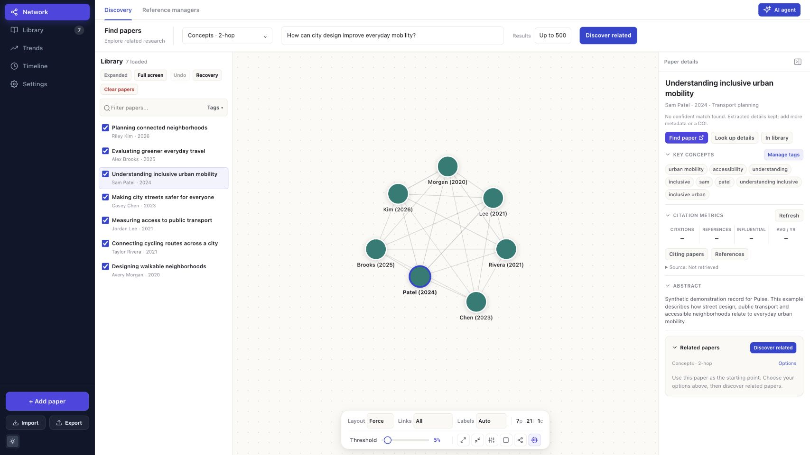

# Pulse local workspace

This is the source used by the current Mac app. It includes direct graph file drops, DOI-first lookup, sourced metrics and citation/reference lists, a compact discovery menu and library sidebar, a full-screen library table with bulk actions, local undo/recovery and a selected-paper AI assistant.



## Run

Requires Python 3.10 or later. From this directory:

```sh
python3 -m venv .venv
source .venv/bin/activate
python3 -m pip install -r requirements.txt
PULSE_CONFIG_DIR="$PWD/.pulse-data" PULSE_PORT=62661 python3 pulse-backend/pulse_backend.py
```

Open the localhost URL printed by the server. The isolated `.pulse-data` directory keeps this copy separate from an existing library. Omitting `PULSE_CONFIG_DIR` uses the application's normal local storage. Serve the frontend through this backend; opening HTML directly does not start the services.

## Library and graph

Drop PDFs, bibliography files or text directly onto the map. Metadata lookup tries DOI first, then available bibliographic fields; ambiguous matches preserve extracted metadata. Paper nodes reopen the inspector; empty graph clicks hide it. Full screen opens the library table. Select rows to export, tag, transfer or remove them. Map visibility checkboxes are independent.

Sort the full-screen table through its column headings. Inspector sections collapse independently. The scrolling timeline fills the canvas, stacks neighboring papers and expands years into months and known dates. Missing days remain unspecified in the metadata and have no placeholder label in the interface.

Undo and Recovery restore removals or a cleared workspace and survive restart. Recovery is local; JSON export creates a portable copy. Clear papers requires confirmation.

## Discovery

Use the Discovery ribbon to enter an optional research question and choose 50–500 results (200 by default). Searches use seed titles, abstracts and keywords, with conservative identity matching, bounded query expansion, rank fusion, normalised citation evidence and optional local semantic reranking. Citation preference is off by default. Avoid keywords lowers priority; Exclude completely removes matching records. Varied perspectives and conservative preprint/published version groups reduce repetition. Progress and cancellation keep longer searches manageable.

Results open in a three-column review workspace with source progress, named match reasons, review queues, grouped matches, filters and an abstract preview. Stop and review keeps completed-source candidates and marks partial results. Bulk action counts follow your selected papers. J/K moves, R/N judges, A adds and Space selects. Reset filters clears every facet. Local relevance labels stay in your workspace. See the [search guide](../docs/SEARCH-SOURCES.md) and [benchmark](../benchmarks/README.md). A locally installed Ollama embedding model is detected automatically; absence or failure falls back to text/citation ranking. Search never downloads a model or sends papers to cloud AI.

## Reports and reference managers

Install and start Ollama separately for optional local reports. Select a paper, then open AI agent. Reports use only that paper's available text, abstract or metadata. Progress, cancellation and downloads are available; model settings are separate from the main report panel. There is no OCR or paywall retrieval.

The Reference managers ribbon tab offers Zotero Desktop transfer and Mendeley RIS export. Shared Mendeley sign-in uses the deployed Pulse token-exchange service. Its application credentials are currently rejected by Mendeley with HTTP 401; the service owner must repair that registration before shared sign-in and sync can work. See the [owner repair guide](../docs/MENDELEY-ACTIVATION.md). Scholarly lookup/discovery uses online services; local Ollama reports use local inference.

Press the active ribbon tab again or double-click it to hide its tools. Reopen it with another press, or switch to the other tab. The AI agent stays in the top right of the toolbar.

## Checks

From the repository root, after installing the requirements above and with Node.js available:

```sh
npm run test:workspace
```

This runs the backend checks and JavaScript regression suites using synthetic data and mocked services. Current desktop packaging stages this directory; see [development notes](../docs/DEVELOPMENT.md).
